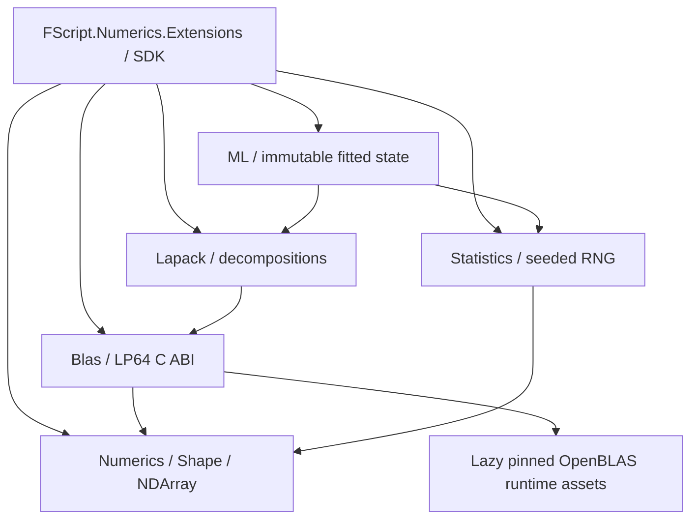
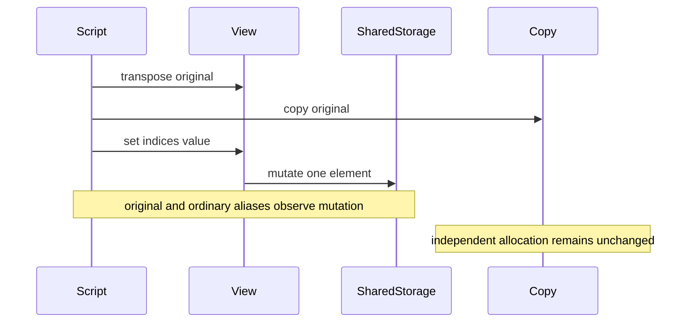

# Numerical architecture

All configuration belongs to this repository. The independent core owns concrete NDArray values; other numerical modules consume that same type. FScript concerns are confined to the aggregate extension and integration tests.

Managed typed storage, immutable shape/element strides/offset and an owner anchor define NDArray. Positive-stride ordinary views share storage. Zero-stride broadcast views carry an explicit read-only flag that propagates through derived views. Arithmetic/composition/conversion outputs allocate private storage. Explicit element mutation remains the one public update mechanism.

The BLAS backend borrows compatible C/F read-only spans or packs unsupported layouts, pins only during synchronous native calls, validates LP64 and exported symbols, and wraps fresh outputs. LAPACK owns overwritten workspaces. Its reusable LU factorization hides factor storage and returns copies for inspection. Backend absence affects execution, not provider discovery.

Fitted models retain only private training results. Predict/transform allocate outputs; getters return copied coefficients/centers/components. SDK snapshots expose Id plus bounded dimensions/convergence metadata. Inspection therefore scales with rank or model metadata rather than observation count. There is no second evaluator, dynamic script dtype inference, provider abstraction or native ownership framework.

System.Numerics.Tensors 11.0.0 remains the contiguous Float64 arithmetic/reduction fast path. Broadcast and strided kernels iterate reusable index vectors; no per-element script values are created inside kernels. Packing and layout copies are measured separately in benchmarks. Checked shape/offset/integer operations guard managed allocation bounds; native calls validate dimensions before entering the C ABI.

[Grounding](../expansion-grounding.md) records the original contract, host/load-context inspection, explicit mutation decision and implementation milestones. [Native backends](../native-backends.md) records binary provenance, platform validation and cancellation limitations. Data/Plotting remain separate future modules.

## SDK 2 and .NET 11

All projects target `net11.0` using the SDK pinned in `global.json`. The production extension references the published `MagnusOpera.FScript.Extensibility` 2.0.0 package. It declares empty SDK 2 type-parameter lists for NDArray and all seven fitted types, preserving their nominal, monomorphic signatures and opaque payload checks. Runtime references remain confined to test and benchmark hosts. Regular integration uses the published FScript 0.94.3 Runtime, CLI, and VSIX server. The optional compiler comparison references the sibling FScript source checkout. Repository metadata and future release comparisons point to FScriptLang, with Magnus Opera authorship unchanged.
