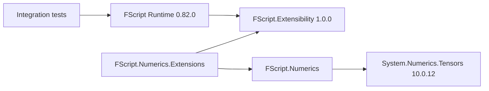
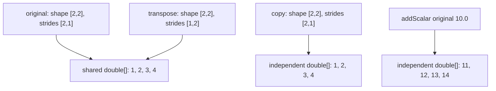

# Layout, storage sharing, and extension architecture

## Repository boundaries



Both production libraries are C# targeting .NET 10. The core has no FScript or FSharp.Core dependency. The extension authors SDK data structures directly; an internal adapter builds F# lists, maps, functions, and curried monomorphic schemes. Only integration tests depend on the interpreter. The SDK owns provider contracts and its stable assembly identity independently of the FScript product version.

## Element strides

An array owns an immutable `Shape`, element strides, an offset, and a reference to a managed `double[]`. Logical indexing computes `offset + sum(index[d] * stride[d])`. Rank is the number of dimensions; size is their product. A scalar has rank zero, shape `[]`, and size one. A zero dimension makes size zero.

A fresh `[2,3]` array has strides `[3,1]`. Transposing gives shape `[3,2]` with strides `[1,3]` and the same backing array. Slicing preserves rank, adjusts the selected dimension and stride, and adjusts the offset. Bounds are strict and stop-exclusive; steps must be positive. Empty slices retain a valid offset without touching storage.



Views retain the backing array directly and remain valid when the original wrapper is collected. There is no disposal or external owner to retain. Inputs and exported arrays are copied; mutable storage is private. `TryGetContiguousSpan` provides read-only access, although subsequent explicit mutations remain observable through that span.

Contiguity means logical row-major order. Singleton-axis strides are ignored, empty arrays are contiguous, and nonzero offsets are allowed. `Reshape` shares storage only for contiguous inputs with equal size; it rejects non-contiguous views. `Copy` always produces independent contiguous storage. `AsContiguous` returns the same instance when already contiguous, otherwise a copy.

Dimension products, strides, offsets, and storage bounds use checked arithmetic. Dimensions, strides, size, and offsets must fit the managed Int32 layout, and element counts must not exceed `Array.MaxLength`. Some enormous empty shapes are consequently rejected if their trailing stride products overflow. Actual allocation remains subject to available memory.

## Immutable bindings with explicit mutation

```fsharp
let original = NDArray.ofRows [[1.0; 2.0]; [3.0; 4.0]]
let view = NDArray.transpose original
let copy = NDArray.copy original
let added = NDArray.addScalar original 10.0
NDArray.set view [1; 0] 9.0
NDArray.toRows original  // [[1;9];[3;4]]
NDArray.toRows copy      // [[1;2];[3;4]]
NDArray.toRows added     // [[11;12];[13;14]]
```

`set` changes exactly one element and returns unit. It does not rebind `original` or change its shape or fields. Script record construction and either record-update syntax are rejected by existing host-managed rules. Neither ordinary arithmetic nor explicit copies mutate their inputs.

## Identity and transport

The opaque SDK payload is the actual core `NDArray`. A weak-key identity table assigns each instance a stable string `Id`; it neither owns nor prolongs the lifetime of arrays. Wrapping the same instance again retains its Id. A distinct view or copy has a new Id even if it shares storage or contains equal values. `contiguous` retains identity when it returns its original input.

The SDK descriptor includes only immutable snapshots: `Id`, `Rank`, `Size`, `Shape`, `DType`. Existing FScript recursive visible-field equality therefore implements identity equality for NDArrays. Hidden numerical storage is never structurally compared or printed. Use numerical functions explicitly; use `toList`/`toRows` to export numerical values. `Unwrap` validates descriptor, metadata, and payload type before returning the actual core instance.

Contiguous elementwise kernels, negation, sum, min, max, and dot use TensorPrimitives. Other layouts iterate logical offsets with one coordinate buffer per traversal, avoiding index-array allocation per element. Matrix operations use direct managed strided loops. Optimized and strided reductions may differ in rounding; bit-identical results are not promised. There is no storage abstraction, native allocation, pooling, ownership framework, or implicit materialization of views.
