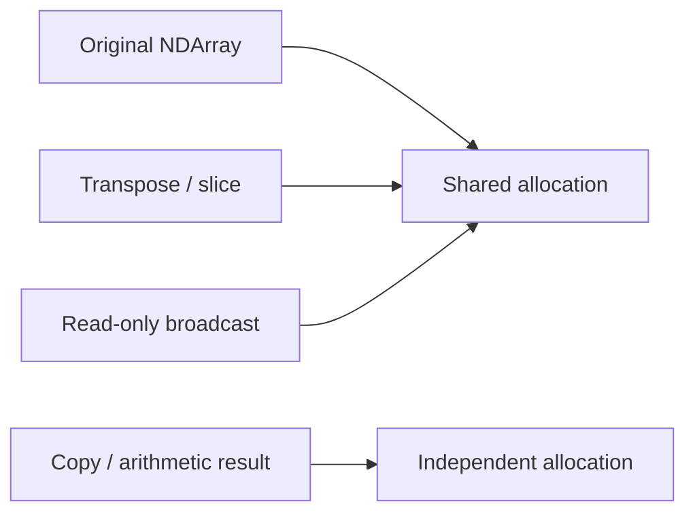

# NDArray contract and .NET API

`NDArray` is sealed. `Shape` is an immutable ordered list of nonnegative dimensions. `DType` is `Float64`, `Float32`, `Int32`, `Int64`, or `Bool`; storage is the corresponding private managed array. Constructors copy input data and dimension/stride metadata. Views retain the allocation directly, so they survive the original wrapper becoming unreachable.

## Metadata and construction

| API | Purpose |
| --- | --- |
| `Shape`, `Rank`, `Size`, `DType`, `Offset`, `Strides` | Immutable layout; offset and strides count elements |
| `IsContiguous`, `IsFortranContiguous`, `IsReadOnly` | C/F layout and broadcast write restriction |
| `Scalar(value, dtype)` | Shape `[]`, one element |
| `FromArray(double[], dtype)` / `FromArray(ReadOnlySpan<double>, Shape, dtype)` | Copy float inputs, optionally converting |
| `FromFloat32`, `FromInt32`, `FromInt64`, `FromBooleans` | Exact typed inputs with optional shape; avoid converting wide integers through double |
| `FromRows(rows)` / `FromRows(dtype, rows)` | Rectangular matrix; empty rows yield `[0,0]`, multiple empty rows retain their row count |
| `Zeros`, `Ones`, `Full`, `Identity` | Fresh arrays, optional dtype defaults to Float64 |
| `Arange(start,stop,step,dtype)` | Stop-exclusive finite progression; step nonzero; wrong direction yields empty |
| `Linspace(start,stop,count,dtype)` | Finite endpoints, inclusive stop for count >= 2; count 0 empty, count 1 contains start |

Checked shape products, strides, offsets, allocation lengths, and integer arithmetic reject overflow. Scalars have size one, zero axes have size zero. A zero-size shape can still reject unrepresentable layout strides. Negative dimensions, ragged/null rows, mismatched data lengths, invalid enum values and invalid axes fail before numerical work.

## Access and views

`Get(params int[])` returns double; `Set(double, indices)` explicitly writes a value after dtype conversion. Integer conversions truncate toward zero and throw on overflow/nonfinite input; float32 rounds to the nearest representable single, potentially infinity. Bool conversion uses `value != 0` (including NaN). Use `GetInt64`/`SetInt64` and `ToInt64Array` for exact Int32/Int64 access, and `GetBoolean`/`SetBoolean`/`ToBooleanArray` for bool. Each requires the corresponding dtype. Exactly rank indices, all nonnegative and in bounds, are required.

| API | Allocation and sharing |
| --- | --- |
| `Transpose()` | Reverses axes, zero-copy |
| `Permute(axes)` | Every axis exactly once, zero-copy |
| `Slice(axis,start,stop,step=1)` | Strict `0 <= start <= stop <= length`, positive step, rank preserved, zero-copy |
| `Reshape(shape)` | Same count and C-contiguous layout required; offset allowed; rejects other layouts |
| `ExpandDims(axis)` / `Squeeze()` | Insert a singleton axis / remove all singleton axes, zero-copy |
| `BroadcastTo(shape)` | Trailing singleton expansion via zero strides; read-only, including derived views |
| `Copy()` / `Flatten()` | Independent writable C-contiguous storage; flatten has shape `[Size]` |
| `AsContiguous()` / `AsFortranContiguous()` | Same object if already in requested layout; otherwise independent storage |
| `Astype(dtype)` | Independent C-contiguous storage even for the same dtype |
| `ToArray`, `ToFloat32Array`, `ToInt64Array`, `ToBooleanArray`, `ToRows` | Independent logical row-major data; ToRows requires rank 2 |
| `TryGetContiguousSpan` / `TryGetContiguousFloat32Span` | Read-only spans for matching contiguous floating storage; false otherwise |

Contiguity ignores singleton-axis strides. Empty layouts are both C- and F-contiguous and do not dereference storage. A broadcast view is read-only even when contiguous; `AsContiguous` can therefore retain read-only status. Call `Copy` to guarantee writable independent storage.

Explicit source/view writes are observed through aliases, including broadcast views. FScript variables and layout snapshots remain immutable. No operation exposes writable storage spans publicly. Simultaneous reads/writes or overlapping writes require caller synchronization.

## Broadcasting and dtypes

Align trailing axes. Dimensions must match or one must be 1. In particular `0` with `1` yields `0`; `0` with a dimension greater than 1 is incompatible. Scalars broadcast to any shape; `[3] + [2,3] -> [2,3]`, `[2,1,3] + [1,4,1] -> [2,4,3]`. Errors include both input shapes. Arithmetic always allocates fresh storage.

| Inputs | Result dtype |
| --- | --- |
| Float64 with any numerical dtype | Float64 |
| Float32 with Float32 | Float32 |
| Float32 with integer | Float64 |
| Int64 with integer | Int64 |
| Int32 with Int32 | Int32 |
| Bool arithmetic / Bool mixed implicitly with numeric | Rejected |

Integer add/subtract/multiply/negate/abs check overflow. Division and power of integers return Float64. Scalar arithmetic accepts double; it retains Float32 for Float32 input and otherwise promotes to Float64. `Exp`, `Log`, `Sqrt`, and `Clip` convert integer input to Float64. Bool arithmetic is rejected, but masks support reductions, composition, and comparisons. Explicit conversion to floats can lose integer precision; float access/conversion is a convenience, not exact Int64 transport.

`EqualElements`, `Less`, `LessEqual`, `Greater`, `GreaterEqual` broadcast to Bool arrays. Integer comparisons retain precision above 2^53. Comparisons with NaN are false. `ContentEquals` requires equal shapes, permits differing dtypes, treats NaN as unequal and signed zeros as equal. `AllClose` additionally requires finite nonnegative tolerances and uses `|a-b| <= atol + rtol*max(|a|,|b|)`; matching infinities are equal, NaN is unequal. It scales extreme float comparisons to avoid overflow. Neither numerical comparison uses object identity.

## Reductions and composition

Whole `Sum`, `Product`, `Mean`, `Min`, `Max`, `Variance(ddof=0)`, `Std(ddof=0)` return double. Whole integer reductions therefore may lose Int64 precision; use axis reductions for checked integer accumulation. `All`/`Any` treat nonzero (including NaN) as true. `SumAxis`, `ProductAxis`, `MinAxis`, `MaxAxis`, `MeanAxis`, `VarianceAxis`, `StdAxis`, `AllAxis`, `AnyAxis` accept one nonnegative axis and optional `keepDimensions=false`. Variance/std also accept nonnegative degrees of freedom and divide by `count-ddof`.

Integer/bool axis sum and product yield Int64, with checked arithmetic. Integer min/max preserve dtype; floating reductions retain dtype. Means/variance/std yield Float32 for Float32 input and Float64 otherwise; masks yield Bool. Variance uses a centered second pass. NaNs propagate in numerical reductions. Optimized and strided reduction paths need not be bit-identical.

Empty sum/dot is 0; product is 1; all is true; any is false. Empty mean/min/max/variance/std throw. Variance also requires more observations than ddof. For axis reductions, these policies apply per output group; a zero-size output has no groups to evaluate.

`Concatenate(arrays,axis=0)` requires nonempty input lists, equal ranks and dimensions outside the axis. `Stack(arrays,axis=0)` inserts an axis and requires equal shapes. Both copy. `Where(condition,whenTrue,whenFalse)` requires a Bool condition, broadcasts all three, and promotes the two branch dtypes. `Clip(minimum,maximum)` rejects NaN/reversed bounds.

Managed `Dot`, `Matvec`, `Matmul` remain available as reference algorithms for float32/64, with no broadcasting or batched operations. See [native backends](../native-backends.md) for the optimized alternatives.
